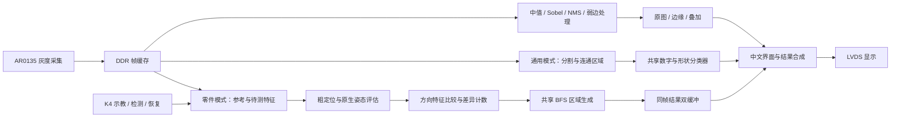

# 系统架构与源码导航

## 数据通路

实时显示与冻结分析分开调度。零件比较读取 DDR 灰度及其特征，不把黄绿色屏幕叠加图作为检测输入。中文叠加只呈现结果，不改变差异判定。

## 关键模块

| 路径（相对于 `project/`） | 职责 |
| --- | --- |
| `example_top.v` | 相机、DDR、显示、按键与各应用集成 |
| `rtl/board_front_v1/` | 实时梯度方向、NMS 与弱边连续性处理 |
| `rtl/image/`、`rtl/video/` | 中值、滑动窗口、Sobel 和动态阈值相关逻辑 |
| `rtl/shared_vision/shared_vision_engine.v` | 共享存储与视觉任务调度 |
| `rtl/shared_vision/multi_target_core.v` | 全画面连通区域分析及零件候选区域复用 |
| `rtl/apps/video_roi_digit_app.v` | 多目标识别显示与分页；模块名中的 ROI 不表示只处理固定窗口 |
| `rtl/apps/shape_geometry_engine.v` | 共享形状／模板分类计算 |
| `rtl/apps/cn_font16.mem` | 中文点阵字库 |
| `rtl/onboard_part/part_local_reference.v` | 参考 A/B 提交、冻结身份、任务生命周期与取消恢复 |
| `rtl/onboard_part/part_auto_native_pipeline.v` | 本地粗定位与原生配准流程 |
| `rtl/onboard_part/part_pose_sample.v` | DDR 特征采样及姿态变换 |
| `rtl/onboard_part/part_compare_tile_pipeline.v` | 分块方向特征与强／弱参考比较 |
| `rtl/onboard_part/part_difference_frame.v` | 全帧分块调度与差异计数图 |
| `rtl/part_assist/part_result_control.v` | 512 项零件结果记录与双缓冲发布 |
| `rtl/onboard_part/part_ddr_mailbox.v` | 跨时钟请求与应答握手 |
| `rtl/control/`、`rtl/keys_osd/` | 运行时协议、帧边界配置、按键和中文状态 |

## 资源复用

通用分割、冻结 Canny 和零件候选区域处理互斥借用灰度 RAM、状态图与前沿队列，减少重复存储。共享灰度容量为 38,400 字节，状态图为每像素 2 位，前沿队列深度 4096；边界与溢出按现有状态机处理。

通用目标队列为 2048 项，零件结果队列为 512 项。每页 8 行属于显示分页，不是总记录容量。设计保留任务、帧、参考和配置标识，结果提交与图像冻结保持一致。
